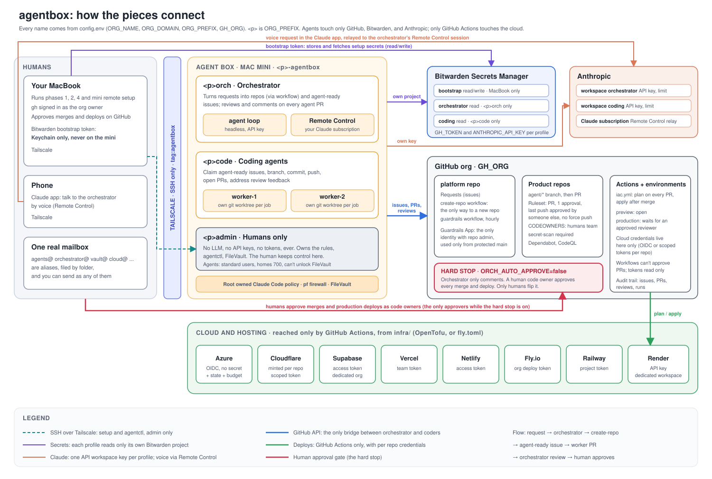

# agentbox

A bootstrap for a software business run by AI agents: one always on Mac mini where an
orchestrator agent plans work and coding agents build it, with GitHub as the only bridge,
Bitwarden holding every secret, and humans holding the keys to production.

Everything is driven by four inputs in [`config.env`](config.env): **organization name,
domain, prefix, and GitHub org**. Change them (see
[`config.example.env`](config.example.env)) and the same recipe sets up a different business.

## Start here: four phases, in order

| Phase | Where you are | Time | Result |
|---|---|---|---|
| **1. [Manual prep](docs/01-manual-prep.md)** | MacBook and browser | 1 to 2 hours | Email aliases into one inbox, Bitwarden, Tailscale, GitHub identities, Claude API keys, cloud accounts |
| **2. [CI/CD setup](docs/02-cicd-setup.md)** | MacBook | 30 minutes | Org rules, the platform repo, guardrails on every repo, cloud credentials in GitHub environments only |
| **3. [Mac mini setup](docs/03-mini-setup.md)** | 20 minutes at the mini, then MacBook | 40 minutes | Human admin account, agents running as services, SSH only over Tailscale |
| **4. [Validation](docs/04-validation.md)** | Phone and MacBook | 30 minutes | Voice request to merged code, with the hard stop proven |

Each phase opens with a checklist and ends with a script that checks it's complete.

## The shape of it

| Role | Lives in | Can | Can't |
|---|---|---|---|
| Human admin | `<prefix>admin` on the mini, your MacBook | Everything; owns the rules | Is never an LLM: no Claude, no tokens in the admin account |
| Orchestrator | `<prefix>orch` | Turn requests into repos (via workflow) and `agent-ready` issues; review PRs | Write code, push, approve or merge while the hard stop is on |
| Coding agents (2) | `<prefix>code` | Claim issues, branch, commit, push, open PRs | Merge, approve, apply infrastructure, hold cloud credentials |
| GitHub Actions | GitHub | Plan and apply `infra/` to cloud providers | Deploy to production without an approved reviewer |

**The hard stop:** `ORCH_AUTO_APPROVE="false"` in `config.env`. While false, the
orchestrator can only comment, GitHub requires a human code owner review on every repo,
and production deploys need a human. Only a human turns it on, with
[`cicd/set-auto-approve.sh`](cicd/set-auto-approve.sh).

## Repo map

| Path | What |
|---|---|
| [`config.env`](config.env) | The inputs. Names only, never secrets |
| [`lib/`](lib) | Config loading and derived names; Bitwarden helpers |
| [`prep/`](prep) | Phase 1 scripts (email, Bitwarden, Tailscale, GitHub, credentials, check) |
| [`cicd/`](cicd) | Phase 2: org settings, platform repo, guardrails, provider connections, the hard stop switch |
| [`mini/`](mini) | Phase 3: remote setup, bootstrap steps, agent profiles, prompts, policy, `agentctl` |
| [`validation/`](validation) | Phase 4: end to end test |
| [`docs/`](docs) | The four phase guides and the architecture diagram |

## No secrets. Ever.

This repo holds the names of secrets, never values. Passwords, tokens, and keys live in
Bitwarden and are fetched at run time or typed at a hidden prompt. Three layers enforce it:
[`.gitignore`](.gitignore), a [pre-commit hook](.githooks/pre-commit) that runs gitleaks
(enabled by `prep/00-install-tools.sh`), and [CI](.github/workflows/ci.yml) scanning full
history.
